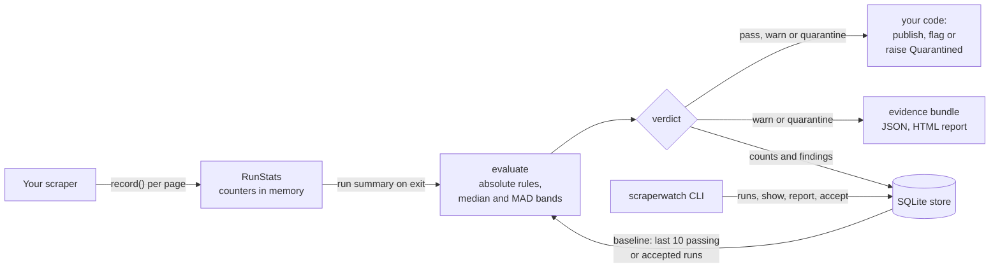

# scraperwatch

[](https://github.com/jamesvincentsiauw/scraperwatch/actions/workflows/ci.yml)

scraperwatch stops a scraper run from publishing data when the run reported success but the data came back empty or incomplete.

A scraper can finish with status success while half its items have an empty price, because a CSS class was renamed, a page template changed, or the site served a challenge page with HTTP 200. Those failures usually surface later, in a dashboard, a manual check or a user report. scraperwatch records what each run extracted, learns what a healthy run looks like for that target, and returns a verdict before the data goes anywhere: pass, warn or quarantine.

Status: 0.1 in development, not yet on PyPI. MIT licensed, no runtime dependencies, Python 3.11 or newer.

## Quick start

Until the first release, install from a clone of this repository:

```bash
pip install .
```

```python
import scraperwatch

with scraperwatch.run("shop-prices", required=["title", "price"], key=["product_id"]) as run:
    for url in urls:
        resp = httpx.get(url)
        run.record(url, parse(resp.text), status=resp.status_code)

if run.verdict.quarantined:
    raise scraperwatch.Quarantined(run.verdict)  # your scheduler marks the task failed
publish()
```

`record()` takes the URL, the items extracted from that page (dicts, dataclasses or Pydantic models), and optionally `status`, `page_type` and `error`. An empty item list matters: it counts as a page that yielded nothing. `record()` does no I/O and is safe to call from several threads.

The first runs of a target only apply absolute rules while scraperwatch collects a baseline. From the fourth healthy run on, every run is compared with the median of up to 10 previous healthy runs.

## How a run is judged



scraperwatch runs inside the scraper process. The baseline is read once when the run starts and the results are written once when it ends, so `record()` never touches the store while pages are being fetched.

## What gets checked

| Check | Fires when | Severity |
| --- | --- | --- |
| `completeness` | A field is filled clearly less often than usual: at least 10 points lower, with the run's whole 95% interval below that line | Quarantine for required fields, warn otherwise |
| `field_collapse` | A field that is usually filled at least half the time is filled 5% of the time or less | As above |
| `required_field` | A required field is filled in under 50% of items, even before a baseline exists | Quarantine |
| `missing_field` | A field present in 90% of items before is gone | As `completeness` |
| `new_field` | A field never seen before appears in over half the items | Warn |
| `type_change` | A field that was one type (number, string, list...) 95% of the time is that type less than 80% of the time | As `completeness` |
| `volume_drop` | The run has under 60% of the usual item count | Quarantine |
| `volume_spike` | The run has over 3 times the usual item count | Warn |
| `page_coverage` | Under 60% of the usual pages were recorded | Warn |
| `empty_pages` | The share of pages with zero items rose by 10 points or more, and the rise is statistically clear | Quarantine |
| `duplicates` | With `key` set, the share of repeated keys within the run rose the same way | Warn, or quarantine when unique items also dropped, which usually means pagination shifted and items were skipped |
| `fetch_errors` | Over half the pages were recorded with `error` | Quarantine |
| `no_items` | The run produced nothing at all | Quarantine |

"Usual" is the median over the baseline runs, and the spread is the median absolute deviation, so one odd run in the history does not move the thresholds. Only runs that passed, or that you accepted, enter the baseline. When a site changes on purpose, accept the new normal with `scraperwatch accept <run-id>`.

## How well it works

A simulation in [simulation/](simulation/) scrapes a fake shop for 30 days per scenario and seed, with daily noise, and injects one incident per history. Results from `python -m simulation.simulate --seeds 30`:

| Scenario | Detected | Quarantined | False alarms |
| --- | --- | --- | --- |
| Price selector renamed on 60% of cards | 64/64 | 64/64 | 0/836 |
| One of five categories returns an empty grid | 64/64 | 64/64 | 0/836 |
| New card template on 40% of pages | 64/64 | 64/64 | 0/836 |
| Challenge page with HTTP 200 on 30% of requests | 64/64 | 64/64 | 0/836 |
| Only half the listing pages are reachable | 64/64 | 64/64 | 0/836 |
| Listings shift by 6 per page during the crawl | 64/64 | 0/64 (warned) | 0/836 |

These numbers only hold for the fake shop's noise, which is described in [docs/evaluation.md](docs/evaluation.md). Real sites can be noisier. The first run of the simulation missed some incidents; the fixes and the changed defaults are in the git history.

## Evidence and reports

When a run warns or is quarantined, scraperwatch writes a bundle to `.scraperwatch/evidence/<target>/<run-id>/`: `summary.json` with the findings, `fields.json` with every field's fill rate against its usual range, `samples.json` with up to 5 example URLs per finding, and for quarantines a `report.html` that opens without network access.

## Command line

```bash
scraperwatch runs [target]                 # recent runs and their verdicts
scraperwatch show <run-id>                 # findings; exit code 0 pass, 1 warn, 2 quarantine
scraperwatch report <run-id> -o run.html   # HTML report
scraperwatch accept <run-id>               # add a run to the baseline
scraperwatch baseline <target>             # what the next run is compared with
scraperwatch prune --older-than 90d
```

## Configuration

Arguments passed to `run()` win over `scraperwatch.toml` in the working directory, which wins over the defaults. `SCRAPERWATCH_CONFIG`, `SCRAPERWATCH_STORE` and `SCRAPERWATCH_EVIDENCE_DIR` override the file's location, store and evidence directory.

```toml
store = "sqlite:///data/scraperwatch.db"   # default .scraperwatch/scraperwatch.db
evidence = true
baseline_runs = 10
min_items = 30                  # smaller runs never enter a baseline
empty_values = ["N/A", "-"]     # strings that count as empty, besides "", None, [] and {}

[targets.shop-prices]
required = ["title", "price"]
key = ["platform", "product_id"]

[targets.shop-prices.fields.discount]
severity = "ignore"             # or "required"
```

Stats are stored in SQLite. Item values are never stored: only counts, type names and sample URLs.

## Duplicates in your own tables

scraperwatch reports duplicates but does not remove them. [docs/storing-items.md](docs/storing-items.md) shows a tested PostgreSQL pattern that stages a run, promotes it only after the verdict, keeps one row per item and adds a history row only when an item changed.

## Not in 0.1

Planned for 0.2:

- Page template change detection from DOM fingerprints. `record()` already accepts `body` for this.
- Block and challenge page detection per domain. It will only detect and report, never bypass.
- Optional HTML snapshots of flagged pages, off by default.
- Slack and webhook alerts, Prometheus metrics.
- PostgreSQL store, a Scrapy extension and a Spidermon monitor.
- Change tracking across runs, to catch stale pages and format changes.

Known gaps: no handling of seasonal patterns such as weekend traffic, nested fields are treated as a single value, and the baseline is count-based (last 10 healthy runs) rather than time-based.

## Development

```bash
uv sync
uv run pytest
uv run ruff check . && uv run pyright
uv run python -m simulation.simulate --seeds 10
```

See [CONTRIBUTING.md](CONTRIBUTING.md).
